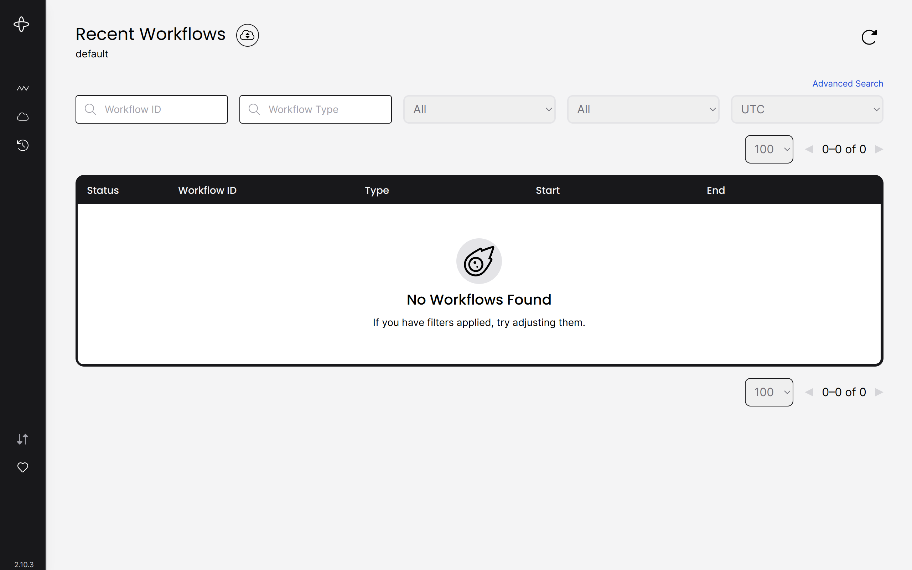

# Deploy Temporal Web UI

This is part of the
[Charmed Temporal Tutorial](https://discourse.charmhub.io/t/charmed-temporal-k8s-tutorial-introduction/11777).
Please refer to this page for more information and the overview of the content.

The Temporal Web UI is a user interface used to interact with and monitor
Temporal workflows and activities.

## Deploy and integrate

1. Deploy the Temporal User Interface (UI):

```bash
juju deploy temporal-ui-k8s --channel 1.31/stable --base ubuntu@26.04
```

2. Wait for the application to require its mandatory relations. The unit will report `blocked` with a message such as:

```
Unit                Workload  Agent  Address     Ports  Message
temporal-ui-k8s/0*  blocked   idle   10.1.0.111         temporal-host-info relation not established
```

3. Integrate with Temporal Server. The UI charm in `1.31/stable` requires **two** relations to reach `active`:

```bash
juju integrate temporal-k8s:ui              temporal-ui-k8s:ui
juju integrate temporal-k8s:temporal-host-info  temporal-ui-k8s:temporal-host-info
```

The `ui` relation provides the routing and rendering bridge to the Temporal frontend. The `temporal-host-info` relation provides the frontend's gRPC host and port. It is **mandatory** in `1.31/stable` and the UI will remain blocked until it is integrated.

4. Wait for both charms to be active and idle. After integration, `juju status --relations` should list both relations:

```
Relation provider                 Requirer                          Interface
temporal-k8s:temporal-host-info   temporal-ui-k8s:temporal-host-info  temporal-host-info
temporal-k8s:ui                   temporal-ui-k8s:ui                  temporal
```

## Access the UI on a web browser

Depending on the local configuration, the Temporal Web UI can be accessed using:

* The unit IP directly:

```bash
TEMPORAL_UI_IP=$(juju show-unit temporal-ui-k8s/0 | yq '.temporal-ui-k8s/0.address')

# In the browser
http://{TEMPORAL_UI_IP}:8080
```

* The ingress IP or DNS name: This requires extra configuration, see [Configure Ingress with Nginx Ingress Integrator](https://discourse.charmhub.io/t/charmed-temporal-k8s-tutorial-deploy-nginx-ingress-integrator/11783) for more details.



> **See next:
> [Deploy Temporal Worker](https://discourse.charmhub.io/t/charmed-temporal-k8s-tutorial-deploy-temporal-worker/11784)**
